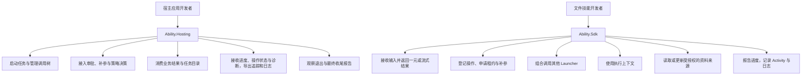
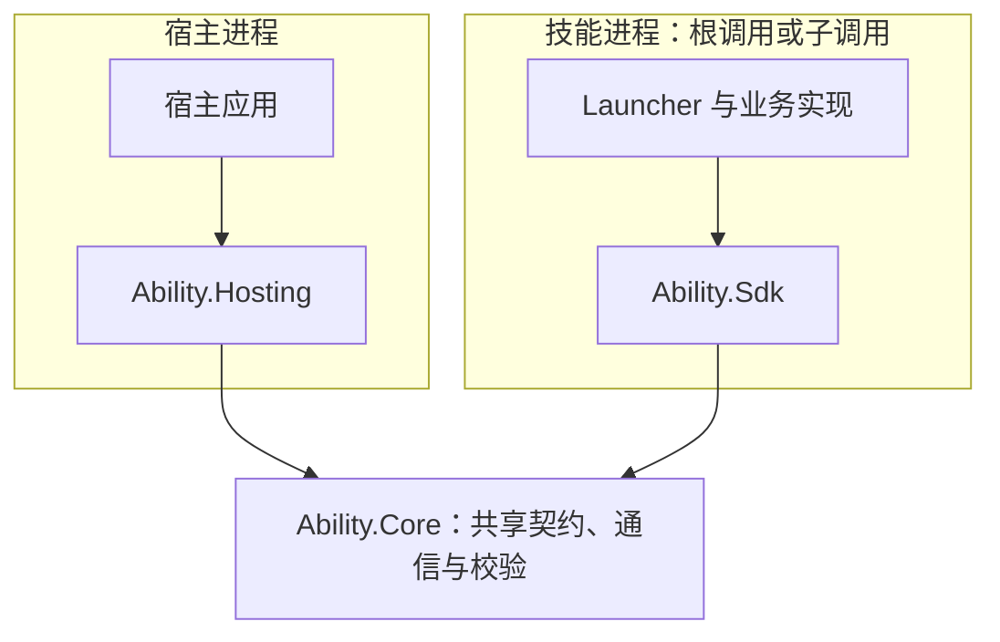
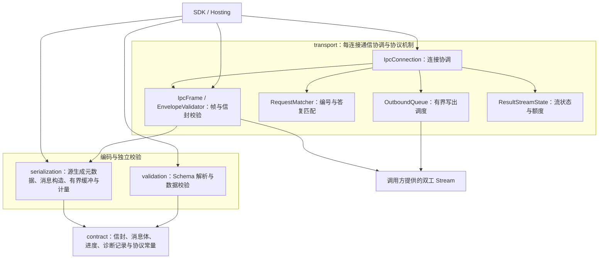
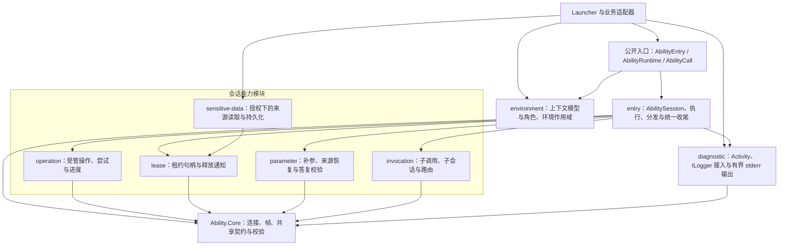
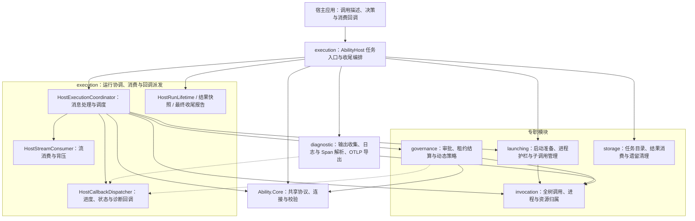
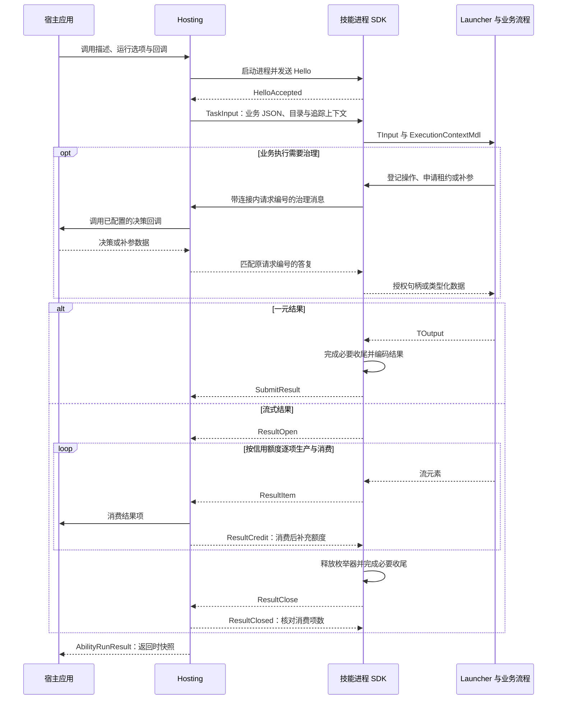
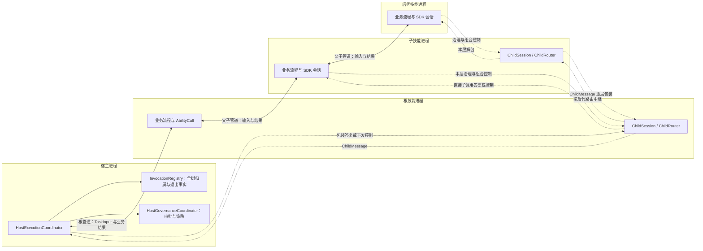
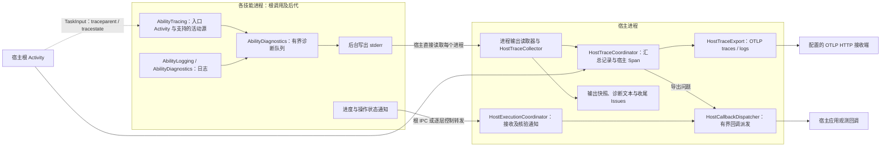
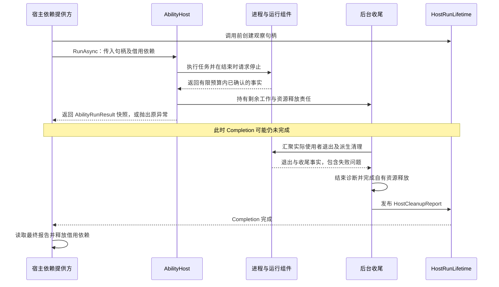

# Ability Framework 架构

本文先说明使用者可以通过框架完成什么，再说明项目依赖、模块职责、数据流和收尾。图中的类型与通信路径对应当前实现；箭头含义在各图前说明。架构优化目标与实施安排集中在 [2.4.2 阶段文件](verification/phase-2.4.2.md)。总约束与术语见 [spec.md](spec.md)，公开接口与实施细节分别见 [core.md](core.md)、[sdk.md](sdk.md)、[hosting.md](hosting.md)。

## 一、架构目的与使用者功能

框架让独立技能进程可以组合执行，并统一处理通信、授权、取消和资源回收。宿主应用发起任务并提供审批及结果消费回调；Launcher 装配业务角色，通过 SDK 执行业务流程。业务流程继续负责业务协作及实际 I/O，框架负责运行机制。

下面的箭头表示使用者接入框架后可使用的功能，不表示消息流向。

架构保持三个核心条件：宿主记录决定进程与资源归属；每项异步工作有明确所有者；业务结果、物理退出与资源释放分别报告。连接编号和额度按连接隔离，停止等待后仍需追踪实际使用者。完整不变量见 [spec.md](spec.md#四业务不变量)。

队列容量、等待预算、内部调度和组件拆分可以随需求调整。调整时保持上述事实与所有权语义，按职责及共同变化的原因组织代码。文件超过 500 行、函数超过 50 行时审查设计，并遵守总规格的 1000／100 行预算；审查关注认知与上下文负担、单一职责、复用及测试调试，数字达标不能替代这些判断。

## 二、项目分层与模块切片

下面是编译依赖图，箭头从引用方指向被引用项目。通信发生在宿主进程与技能进程之间，见第六节。

Core 提供共享通信与校验，Sdk 为文件技能提供接入能力，Hosting 为宿主提供调用管理。Sdk 与 Hosting 均依赖 Core，不相互引用；运行时各进程加载自己所需的程序集，不共享 Core 内存状态。Sdk 的 MSBuild 预设随包分发，负责文件式构建约定，不参与运行时通信或会话所有权。

项目分层确定依赖方向，各项目内再按能力目录切片。基础设施按职责组织，业务文件按全局文件切片规约组织；协议消息体、配置、运行状态或内部辅助类型属于基础设施，不机械套用业务 DTO 的文件命名与共址规则。

## 三、Core 内部架构

Core 提供双方共用的通信机制和规则。按以下模块组织：

下图从上层调用入口展开到通信组件、编码与契约。实线表示主要使用或组合关系。`validation` 是可独立调用的校验能力，不要求每次帧读写都经过 Schema 校验；诊断记录的数据定义属于 `contract`，采集与导出由两端负责。

| 模块目录 | 职责 | 依赖与状态 |
| --- | --- | --- |
| `contract` | 信封、消息体、诊断记录契约和协议标识 | 只表达共享数据及含义 |
| `serialization` | 源生成序列化元数据、字节计量及编码校验 | 使用契约与调用方的类型元数据 |
| `transport` | 帧读写、连接生命周期、请求匹配、发送调度及结果流协议状态 | 每条连接分别持有通信状态 |
| `validation` | Schema 解析与数据校验等两端共用的规则 | 可独立调用；缓存和计算资源由本模块管理 |

`transport` 由连接协调者组合帧读写器、请求匹配器和出站调度器。帧读写器负责字节边界；请求匹配器持有请求编号与等待者；出站调度器持有待写帧及其容量名额。结果流组件维护流状态和额度。连接协调者负责它们的启动、终止和协作顺序。

连接向上层交付消息和连接事件。Sdk 处理本地执行与控制转发，Hosting 处理审批和进程治理。上层处理与通信循环分别执行，避免一项外部决策拖住整条连接。

`serialization` 与 `validation` 可分别使用。Schema 的演进局限在校验模块；基础帧读写无需理解参数要求。共享规则集中实现，Sdk 与 Hosting 通过 Core 使用同一套机制。

Core 的错误类型表达通信和校验事实，Sdk 与 Hosting 各自将其转换为调用异常或治理答复。连接接收已建立的双工流，管道创建、进程启动和业务回调由上层安排。这样共享机制可以独立演进，两端也能保持各自的执行方式。

## 四、Sdk 内部架构

Sdk 以调用会话作为内部运行对象。会话持有本次调用的连接及能力组件，安排入口执行和收尾。对外静态门面通过 `AsyncLocal` 找到当前会话；可变的通信与资源状态保存在会话实例中。

下图按接入、会话协调、能力模块和通信底座展开。实线表示主要使用或协调关系，不是完整的类型依赖图。执行环境和诊断可由公开入口独立使用；它们不需要先取得租约。业务流程通过 Launcher 装配的角色工作，图中只展示框架调用关系。

| 模块目录 | 职责 | 所有权与协作 |
| --- | --- | --- |
| `entry` | 公开接入门面、模型编解码、委托执行和调用会话协调 | 会话持有连接及能力组件，统一安排释放 |
| `environment` | 执行环境、上下文模型与角色、作用域切换 | 可独立建立环境，便于直接测试业务方法；上下文模型 ExecutionContextMdl 置于 `Ability.Model` 命名空间，遵循全局规约采用 partial 结构与 AsExecutionContext 投影文件，角色 IExecutionContext 置于 `Ability.Role` 命名空间 |
| `lease` | 租约申请、句柄和释放通知 | 持有本次调用的租约句柄，通过连接通信 |
| `parameter` | 补参描述、答复解码、Schema 校验及来源恢复请求 | 使用 Core 校验模块，向会话报告失败；补参请求模型 ParamRequestMdl 置于 `Ability.Model` 命名空间 |
| `operation` | 操作登记、尝试生命周期、策略应用及进度汇总 | 操作持有自身状态、局部控制信号与进度缓冲；运行策略模型 RunPolicyMdl 置于 `Ability.Model` 命名空间 |
| `invocation` | 子调用 API、子会话与控制消息转发 | `ChildSession` 管理单个子调用的停止协议结果；`ChildRouter` 管理直接子会话、后代路由及会话级停止失败摘要 |
| `sensitive-data` | 资料来源配置、授权后的快照读取与来源适配 | 将来源实现与调用方使用的引用、快照契约分离；敏感来源引用模型 SensitiveSourceRefMdl 置于 `Ability.Model` 命名空间 |
| `diagnostic` | 原生追踪、日志接入及结构化诊断输出 | 管理诊断采集与缓冲，通过共享契约输出记录 |

会话负责组合组件，组件通过完成职责所需的窄接口或委托协作。组件间的依赖在构造时明确传入，避免把整个会话传给每个组件再由其自行查找服务。

`build/` 保存随 NuGet 包自动导入的告警与隔离编译预设，不参与上述运行时模块协作。开发环境的 Directory.Build.props 管理过渡期扩展名映射。资源读取属于业务代码，直接使用所属程序集和 .NET 文件 API。

执行环境与通信会话分别管理。设置时间、取消和进度条件可以独立于 IPC 完成；租约、补参和子调用等操作则要求有效的通信会话。子管道使用 Core 的 `IpcFrame` 帧编解码；`ChildSession` 管理单个子调用的协议和生命周期，`ChildRouter` 维护路由拓扑并汇总停止失败，供会话收尾决定是否释放租约。

Sdk 管理自己创建的连接、枚举器和控制资源，业务代码管理业务可释放模型。租户、身份和工作单元通过业务角色参数传入流程；当前会话与执行环境的隐式关联只服务于 Sdk 执行和治理。业务流程形参仍为角色，Launcher 处理委托接收 TInput 和 ExecutionContextMdl 属于 SDK 接入契约，不混淆两者。流程与 Launcher 均允许直接读取已取得模型或 DTO 的公开数据，无需为属性读取设立冗余角色；业务输出适用模型与 DTO。进程内可以用具名元组表达独立结果；IPC 直接交付仍须满足源生成元数据与消息契约，并取得具体序列化验证证据，不承诺任意元组无条件往返。具体借用、移交及释放条件见 [sdk.md](sdk.md)。

资料来源变化通过 `sensitive-data` 的来源适配处理。快照契约表达版本与一致性，来源配置表达解密或远端访问要求，授权完成后才读取数据。适配器的普通业务 I/O 继续使用业务选择的客户端库，Sdk 专注于接入与治理能力。

## 五、Hosting 内部架构

Hosting 向宿主应用提供任务执行入口，由任务协调者组合以下模块：

下图把公开入口、运行协调和专职模块分开。实线表示主要使用或协调关系；虚线表示向可观测性通道提供诊断。`invocation` 是权威状态来源，`launching` 按记录操作进程。`diagnostic` 横跨运行过程，不串在审批与结果处理的必经路径上。

| 模块目录 | 职责 | 所有权与协作 |
| --- | --- | --- |
| `execution` | 任务入口、消息分发、事件处理及收尾编排 | 持有任务的运行组件和上游业务交互回调 |
| `invocation` | 权威调用登记表及状态转换 | 集中记录调用关系、进程身份、操作和资源归属 |
| `launching` | 启动路径准备、进程护栏和子调用管理 | 护栏依据权威调用记录操作实际进程，准备组件提供启动描述 |
| `governance` | 租约、补参、来源恢复与运行策略的决策接入 | 持有未决审批，调用宿主回调并应用答复 |
| `storage` | 任务临时目录、旁路结果接管及遗留资源处理 | 持有目录归属与处理状态，向任务协调者报告结果 |
| `diagnostic` | stderr 收集、结构化记录解析及观测导出 | 接收护栏提供的输出流和调用记录，独立管理导出 |

任务协调者保留可顺读的执行主流程。消息按结果、治理和子调用等用途分组处理，处理结果通过明确的返回值或事件交给协调者。公共连接机制来自 Core。

调用登记表是进程与资源归属的统一依据。模块通过登记表提供的操作读取和转换状态；实际进程操作交给护栏。这样启动与取消交错时，登记表仍能决定新启动的进程归属谁、是否继续执行。

当前启动准备组件检查既有 Launcher 路径，区分托管程序集与原生可执行文件，产出命令、参数和工作目录。它不负责构建 Launcher，也不创建需移交的准备资源。任务协调者负责随后创建的管道、目录和进程。增加启动形态时先在准备组件和启动描述内明确所需契约。

宿主回调表达决策与业务结果消费，Hosting 表达执行机制。回调需要的调用信息通过明确的数据传入，结果及失败均回到任务协调者。界面、黑板和 AI 的实现留在宿主应用。

## 六、输入、结果、治理与观测的数据流

### 1. 根调用

下图展示正常调用的主要消息和进程内数据，观测路径在第 3 小节单独展开。跨进程数据使用 JSON 信封与帧传输；SDK 使用 Launcher 提供的 `JsonTypeInfo<T>` 恢复业务输入及编码输出。宿主使用共享契约处理 JSON 或结果引用，无需引用技能的业务程序集。

初始额度在握手中协商；后续额度随消费补充，将宿主消费速度传回技能生产端。异常、取消和失败收尾按项目规格处理，正常终态不能代替进程退出确认。超过消息载荷限制的结果可使用任务目录中的文件及结果引用，由宿主按目录消费契约接管。

### 2. 子调用与控制路由

父调用通过 `AbilityCall` 请求宿主登记并启动子 Launcher，然后在父子管道上完成握手、输入和结果交换。子调用沿用同一种 Launcher 接入方式，可以继续发起后代调用。

下图中的实线表示业务输入与结果路径，虚线表示转发到宿主的治理及组合控制路径。进程启动由宿主执行；图省略启动和握手消息，独立的 stderr 观测路径见下一小节。

子结果返回其直接父调用，由父业务决定如何继续处理或组合成自己的输出。宿主通过根连接接收根结果；子结果帧不混入 `ChildMessage` 控制转发。后代治理请求逐层包装上行，宿主核验相邻调用归属后裁决，再沿对应路由返回答复。

每层代理请求与内层业务请求分别保留编号及匹配关系。SDK 路由表负责找到下一跳，宿主权威登记表决定该调用是否存在、属于谁以及是否已退出。路由存在不能作为授予资源或确认退出的依据。

### 3. 可观测性

可观测性有两条不同路径。进度与操作状态沿 IPC 控制路径传给宿主；日志与 Span 经各技能进程的 stderr 输出，由宿主分别收集。子进程的日志不经父技能的 `ChildMessage` 中继。宿主把追踪上下文放入 `TaskInput`，父技能启动子调用时继续传递当前上下文，使记录可以关联到同一任务。

下图实线表示观测数据流，虚线表示追踪上下文传递。OTLP 导出仅在配置端点时执行，宿主回调按运行选项接入。

Core 定义进度、诊断记录及追踪字段的共享契约，不启动采集或导出工作者。SDK 管理自身的活动监听和有界输出；Hosting 管理进程输出读取、回调隔离及可选导出。普通输出快照与结构化记录分别保留，stdout 不作为业务结果协议。

诊断处理失败记入相应报告，不改变已经接受的业务结果。有限排空结束后仍在执行的读取、回调和释放工作继续纳入实际退出追踪；第七节说明何时允许提供方释放它们使用的依赖。

## 七、前台返回与实际收尾

`RunAsync` 在有限等待后返回结果快照，或按原调用契约抛出异常。尚未结束的回调、取消和释放工作继续由所属组件持有。需要管理借用依赖的提供方在调用前创建 `HostRunLifetime`，并观察其 `Completion`；该信号完成后才能释放仍被本次运行使用的依赖。

下图表示允许存在迟到工作的收尾过程。各组件仍分别管理自身任务，图中的“后台收尾”由当前 `AbilityHost` 与组件完成信号协调。

快照不因迟到工作而改写。`Completion` 表示实际使用及收尾工作已结束，最终报告分别说明进程退出确认、治理结算、目录处置、诊断结束和清理是否成功；完成信号本身不保证所有清理成功。观察等待超时后，提供方仍需持有相关依赖。

SDK 同样区分停止等待与实际退出。枚举器推进和释放顺序执行；未确认业务操作及子调用停止时保留活动租约，宿主只依据真实退出事实执行回收。预算、异常分类及目录处置条件以 [sdk.md](sdk.md) 和 [hosting.md](hosting.md) 为准。

## 八、组件协作与扩展

每份可变状态有明确的所有者。Core 持有通信状态，Sdk 持有本地执行状态，Hosting 持有权威进程和资源记录。跨组件更新通过方法或事件完成，集合的内部可写引用由所属组件保管。

状态转换在短时同步范围内完成，管道 I/O、宿主回调和业务委托在同步范围之外执行。组件接口须说明何时完成、怎样失败、谁负责取消及释放。资源移交成功后由接收方负责，移交失败由原所有者处理。

扩展接口设在已有替换需求处：宿主决策、启动准备和资料来源。内部优先使用具体类型组合，组件按职责和共同变化的原因拆分。协议公共规则留在 Core；新增业务能力通过 Sdk 与 Hosting 的对应组件接入。

项目间公开协作所需的契约，项目内组件默认保持内部可见。目录用于组织职责，组件通过实际需要的方法协作；新增接口应有具体调用者或替换需求。具体签名随对应模块实施补充，跨项目的所有权与完成语义以项目规格为准。

当前 Hosting 的运行编排由 `AbilityHost` 及其辅助方法完成，必要答复交付分别位于执行与治理协调器；SDK 子连接使用 `IpcFrame` 并维护自身结果状态。后续集中运行所有权或复用交付、结果流规则时，应保持上述协议路径和公开完成语义。本文图示不将这些候选优化视为已实现组件。
